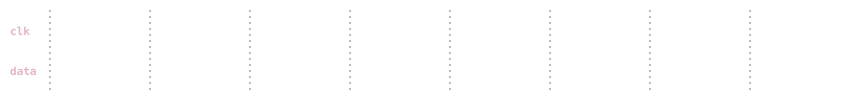
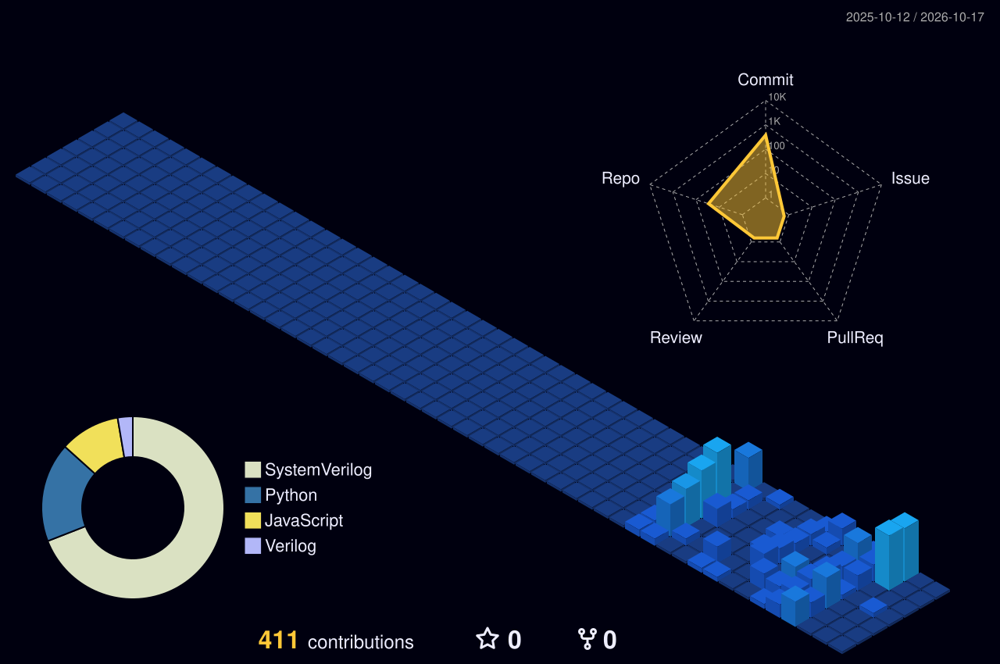

  

  
  
  
  
  

  
   
  
  
  

 

## 🔬 About Me

Transitioning 2+ years of production embedded firmware engineering and multi-layer hardware bring-up into **RTL Design & Verification**, bringing practical hardware-software co-design intuition to verification closure. 

I specialize in **SystemVerilog, UVM, and protocol verification (AMBA-APB, AXI4-Lite)** to architect, verify, and validate digital microarchitectures. From designing and verifying 5-stage pipelined RV32I RISC-V processor cores to proving formal mathematical properties in Cadence JasperGold, I bridge the critical gap between embedded firmware, gate-level RTL, and silicon-grade verification.

- 🎓 **Education:** Final-year B.Tech in Electronics & Telecommunication Engineering (EXTC) at MAEER's MIT College of Railway Engineering & Research (MITCORER), Barshi (*Punyashlok Ahilyadevi Holkar Solapur University*), graduating in 2026 with a **CGPA of 7.86**. Prior Diploma in Railway Engineering / Electrical Engineering with distinction (**Grade 9.6 / 10**).
- ⚙️ **Engineering Trajectory:** `Embedded Systems` &rarr; `Digital Design` &rarr; `RTL & UVM Verification` &rarr; `SoC / ASIC`
- 🎯 **Current Focus:** Advanced UVM testbench architectures (virtual sequences, register abstraction layers), formal property verification (FPV) in JasperGold, and Low Power Design/Verification using Unified Power Format (UPF).

 

## ⚡ Engineering Focus & Technical Pillars

<table>
  <tr>
    <td width="33%" valign="top">
      <h3 align="center">🔌 Embedded Firmware</h3>
      <ul>
        <li><b>Platforms:</b> STM32, ARM Cortex-M (M0/M3/M4), Nordic nRF52840/nRF52833, LPC1768</li>
        <li><b>Firmware:</b> Embedded C/C++, Bare-Metal HAL, FreeRTOS preemptive multitasking</li>
        <li><b>Peripherals:</b> UART, SPI, I2C, ADC, PWM, Timers, Interrupt Controllers (NVIC)</li>
        <li><b>Low Power:</b> System ON/OFF sleep states, RTC wake triggers, power profiling</li>
        <li><b>Hardware Bring-Up:</b> Multi-layer PCB debugging, signal integrity, oscilloscopes, logic analyzers</li>
      </ul>
    </td>
    <td width="33%" valign="top">
      <h3 align="center">📐 RTL &amp; Digital Design</h3>
      <ul>
        <li><b>HDLs:</b> SystemVerilog, Verilog, VHDL (familiar)</li>
        <li><b>Microarchitecture:</b> 5-stage RV32I pipelined datapath, hazard detection, forwarding</li>
        <li><b>Subsystems:</b> Parameterizable Sync &amp; Async FIFOs, Gray-code CDC synchronizers</li>
        <li><b>Control Logic:</b> Mealy/Moore FSM architectures, register maps, address decoding</li>
        <li><b>Optimizations:</b> Clock gating, reversible-logic SECDED ALU, Low Power (UPF)</li>
      </ul>
    </td>
    <td width="34%" valign="top">
      <h3 align="center">🧪 Design Verification</h3>
      <ul>
        <li><b>Methodology:</b> UVM 1.2 (drivers, monitors, sequencers, agents, scoreboards)</li>
        <li><b>Stimulus:</b> Constrained-random stimulus, transaction-level modeling (TLM)</li>
        <li><b>Formal Verification:</b> SVA (SystemVerilog Assertions), JasperGold FPV</li>
        <li><b>Coverage:</b> Functional coverage models (covergroups, coverpoints, crosses), code coverage</li>
        <li><b>Simulation &amp; EDA:</b> Cadence Xcelium, QuestaSim/ModelSim, Synopsys DC, Vivado</li>
      </ul>
    </td>
  </tr>
</table>

 

## 💼 Professional Experience & Industrial Training

#### 🔹 **The Silicon Sandbox** — *Trainee, Advanced RTL Design & Verification Intern*
*`Jun 2026 – Present` | Bengaluru, Karnataka, India (On-site)*
- Conducting advanced industrial verification in **SystemVerilog** and **Universal Verification Methodology (UVM)** for complex digital IP blocks.
- Constructing layered, reusable UVM testbench architectures comprising drivers, monitors, sequencers, and self-checking scoreboards with constrained-random stimulus.
- Developing **SystemVerilog Assertions (SVA)** for protocol compliance and formal property verification in **Cadence JasperGold**.
- Executing functional coverage closure and code coverage analysis in **Cadence Xcelium** with Unified Power Format (UPF) low-power verification.
- *(The Silicon Sandbox, Bangalore; MSME Registered, AICTE & VTU Approved)*.

#### 🔹 **Velaxtra Pvt Ltd** — *Sr Embedded Firmware Engineer*
*`Oct 2025 – Jun 2026` | Bengaluru, Karnataka, India (On-site)*
- Engineered production embedded C firmware and low-level peripheral device drivers for industrial telemetry and smart monitoring hardware.
- Implemented high-reliability non-blocking drivers for **UART, SPI, I2C, ADC, and PWM** peripherals integrated with **FreeRTOS** priority queues and mutexes.
- Accelerated board bring-up by correlating firmware execution traces with hardware oscilloscope and logic analyzer captures.
- Collaborated closely with board hardware designers on multi-layer PCB defect isolation and schematic-to-board correlation.

#### 🔹 **Minilec India Private Limited** — *Embedded System Engineer*
*`Jul 2024 – Sep 2025` | Pune City, Maharashtra, India (On-site)*
- Designed and debugged **STM32 / ARM Cortex-M** embedded control firmware for high-volume production units (motor protection and industrial monitoring relays).
- Performed extensive multi-layer PCB-level debugging, signal-integrity diagnostics, and schematic-to-board defect correlation in high electrical-noise environments.
- Diagnosed analog signal-conditioning anomalies, eliminating intermittent field faults across industrial relay product lines.
- Standardized factory production testing and hardware verification procedures for production units.

#### 🔹 **Saksham Semiconductors** — *Analog Circuit Design Intern*
*`May 2024 – Jul 2024` | Hyderabad, Telangana, India (On-site)*
- Characterized MOSFET small-signal and large-signal behavior across process, voltage, and temperature (PVT) corners in **SPICE**.
- Designed and simulated CMOS current-mirror references and differential-amplifier topologies.
- Conducted DC, AC, transient, and parametric sweep analyses for analog front-end blocks, building foundational knowledge for mixed-signal (AMS) verification.

 

## 📜 Verified Certifications & Training

- **Advanced RTL Design & Verification** — *The Silicon Sandbox* (MSME Registered, AICTE & VTU Approved)
- **VLSI System On Chip (SoC) Design** — *Maven Silicon*
- **RTL Design & Verification** — *ChipXpert*
- **VLSI Design Flow: RTL to GDS** — *ChipXpert*
- **Semiconductor Technology** — *IIT (BHU), Varanasi*
- **ARM Cortex-M3 LPC1768 Microcontroller** — *Indian Institute of Embedded Systems (IIES)*
- **ARM Assembly Programming Foundations** — *OliveStem U*

 

## 🚀 Featured Projects

### 1. 32-bit RISC-V Processor Design & Verification (RV32I)
*`SystemVerilog` • `UVM 1.2` • `Cadence Xcelium` • `SkyWater 130nm Flow`*
- Architected a 5-stage pipelined RV32I RISC-V processor core (Fetch, Decode, Execute, Memory, Writeback).
- Integrated dynamic hazard detection, pipeline stall logic, and full operand forwarding unit across EX and MEM stages.
- Developed a complete layered UVM 1.2 verification environment: transaction sequences, driver, monitor, memory responder agent, and scoreboard checking against Spike reference logs.
- Achieved **95%+ functional coverage closure** in Cadence Xcelium with constrained-random instruction sequences.
- 🔗 **Repository:** [abhijit-karale/riscv-soc-verification](https://github.com/abhijit-karale/riscv-soc-verification) | 🌐 **Case Study:** [Portfolio Overview](https://abhijit-karale.github.io/Portfolio/)

### 2. Memory Controller with Formal Property Verification
*`SystemVerilog` • `SVA (Assertions)` • `Cadence JasperGold FPV`*
- Designed a synthesizable single-port read/write memory controller with address range decoding and deterministic reset behavior.
- Authored comprehensive SystemVerilog Assertions (SVA) checking address boundary integrity, read-after-write dependencies, and protocol transitions.
- Achieved **100% exhaustive mathematical proofs** in JasperGold Formal Property Verification (FPV), verifying corner cases unreachable by dynamic simulation alone.

### 3. Parameterizable Asynchronous FIFO with Gray-Code CDC
*`Verilog` • `SystemVerilog` • `Clock Domain Crossing (CDC)` • `SVA`*
- Implemented a dual-clock FIFO supporting independent write and read clock domains.
- Utilized Gray-code pointer encoding and 2-flip-flop synchronizers to prevent metastability across asynchronous clock domain crossings (CDC).
- Formulated pessimistic full and empty flag generation logic to ensure data integrity; validated with protocol assertions and stress testbenches.

### 4. AMBA-APB Slave Peripheral
*`SystemVerilog` • `AMBA-APB Protocol` • `FSM Design` • `Assertions`*
- Designed an APB-compliant slave peripheral implementing the standard IDLE / SETUP / ACCESS finite state machine.
- Integrated memory-mapped configuration registers with address decode logic and error response reporting.
- Verified protocol compliance using constrained-random stimulus generation and SystemVerilog Assertions checking setup-to-enable timing.

### 5. Multi-Peripheral Industrial Firmware Engine
*`Embedded C` • `FreeRTOS` • `STM32 / ARM Cortex-M` • `Keil µVision`*
- Architected a production-grade preemptive multitasking firmware framework integrating five peripherals: **UART, SPI, I2C, ADC, and PWM**.
- Coordinated multi-sensor acquisition using FreeRTOS task queues, semaphores, and mutexes with zero task starvation and bounded interrupt latencies.
- Validated timing compliance and signal integrity on hardware using digital storage oscilloscopes and logic analyzers.

### 6. Ultra-Low-Power BLE Firmware for Edge Devices
*`Embedded C` • `Nordic nRF52840 / nRF52833` • `BLE 5.0` • `Power Profiling`*
- Engineered battery-optimized firmware implementing fine-grained System ON and System OFF sleep states.
- Configured real-time clock (RTC) triggers and peripheral state retention, substantially reducing quiescent current draw.
- Conducted laboratory power profiling to extend battery operating lifetime for remote telemetry nodes.

### 7. Industrial SCR Motor Drive Firing Package Diagnostics
*`Analog Diagnostics` • `Oscilloscope` • `Industrial Controls` • `Komatsu/Joy SCR 601849-121`*
- Isolated firing-circuit and gate-trigger failure modes in high-power industrial SCR motor drive packages.
- Correlated schematic-to-board signal paths with oscilloscope wave captures, resolving analog gate pulse degradation.
- Established a repeatable diagnostic protocol that transformed ad-hoc repair into a standardized factory testing procedure.

 

## 🛠️ Technical Skills Matrix

<table>
  <tr>
    <td width="25%" valign="top">
      <b>Languages</b>  
       
       
       
       
       
      
    </td>
    <td width="25%" valign="top">
      <b>Embedded Systems</b>  
       
       
       
       
       
      
    </td>
    <td width="25%" valign="top">
      <b>RTL &amp; Verification</b>  
       
       
       
       
       
      
    </td>
    <td width="25%" valign="top">
      <b>EDA &amp; Lab Tools</b>  
       
       
       
       
       
      
    </td>
  </tr>
</table>

 

## 🌌 GitHub Activity & Contributions

  
   
  <i>Contribution visualization — real repository activity and commit history across embedded &amp; silicon IP projects.</i>

 

## 🎓 Education & Academic Leadership

- **Bachelor of Technology (B.Tech) — Electronics & Telecommunication Engineering**  
  *MAEER's MIT College of Railway Engineering & Research, Barshi (Punyashlok Ahilyadevi Holkar Solapur University)*  
  **Duration:** 2023 – 2026 | **CGPA:** 7.86  
  *Core focus: Digital VLSI System Design, Embedded Systems Architecture, Hardware Description Languages (Verilog/SystemVerilog), and Microcontroller Interfacing.*

- **Diploma in Railway Engineering / Electrical Engineering**  
  *MAEER's MIT College of Railway Engineering & Research, Barshi, Solapur*  
  **Duration:** 2021 – 2024 | **Grade:** 9.6 / 10 (Distinction)  
  *Foundational curriculum in electrical machines, control systems, industrial instrumentation, and power electronics.*

- **Vice President — Electronics & Telecommunication Students Association (ETSA)**  
  *MAEER's MIT College of Railway Engineering & Research* | `2024 – 2025`  
  *Organized technical workshops and competitive hackathons for 200+ engineering students; mentored juniors in microcontroller firmware bring-up and VLSI career paths.*

 

## 📬 Connect & Professional Links

  
  
  
  
  

 

  

